# Full-Stack Student Management System & AI Testing Agent

A production-grade full-stack student management application engineered with **Spring Boot 4.1.0 (Java 25)**, **MySQL**, and **React 19**, paired with an **autonomous AI API Testing Agent** powered by **Qwen3 4B** and **Ollama**.



---

## Table of Contents
1. [Project Overview](#project-overview)
2. [Full-Stack Architecture](#full-stack-architecture)
3. [Technology Stack](#technology-stack)
4. [AI-Powered API Testing Agent](#ai-powered-api-testing-agent)
5. [Why Local Qwen3 Instead of Paid APIs?](#why-local-qwen3-instead-of-paid-apis)
6. [Prerequisites & Quickstart](#prerequisites--quickstart)
7. [API Endpoints Specification](#api-endpoints-specification)
8. [Automated Testing & Validation](#automated-testing--validation)

---

## Project Overview

This project provides an end-to-end platform for academic record lifecycle management, featuring:
- **Spring Boot REST Backend:** Secure CRUD APIs with dual deletion modes (soft-delete archiving via `PATCH` and permanent purge via `DELETE`), automated JPA auditing (`@CreatedDate`, `@LastModifiedDate`), and multi-tier Jakarta validation.
- **Modern React 19 SPA:** Responsive administrative dashboard with real-time client search, modal form validation, skeleton loading states, and toast notifications.
- **Autonomous AI Testing Agent:** A locally running Node.js agent integrating **Qwen3 4B** via Ollama. It accepts natural-language test instructions, selects from 7 allowlisted tools, intercepts dangerous operations with confirmation gates, and executes an independent deterministic validation engine.

---

## Full-Stack Architecture

```
                                  USER INTERFACE / CLIENTS
                     ┌───────────────────────┬───────────────────────┐
                     │                       │                       │
                     ▼                       ▼                       ▼
              React 19 Frontend        Node.js AI Agent        Direct HTTP Client
             (http://localhost:5173)     (Qwen3 4B + Ollama)      (Postman / cURL)
                     │                       │                       │
                     └───────────────────────┼───────────────────────┘
                                             │ HTTP JSON Requests (CORS: 5173)
                                             ▼
                                ┌─────────────────────────┐
                                │   Servlet Filter Chain  │
                                │ • LoggingFilter (Ord 1) │
                                │ • TimingFilter  (Ord 2) │
                                └────────────┬────────────┘
                                             ▼
                                ┌─────────────────────────┐
                                │ Spring MVC Interceptor  │
                                │ • LoggingInterceptor    │
                                └────────────┬────────────┘
                                             ▼
                                ┌─────────────────────────┐
                                │    StudentController    │
                                │ • DTO Validation @Valid │
                                └────────────┬────────────┘
                                             ▼
                                ┌─────────────────────────┐
                                │     StudentService      │
                                │ • @Transactional safety │
                                │ • Entity-DTO Mapper     │
                                └────────────┬────────────┘
                                             ▼
                                ┌─────────────────────────┐
                                │    StudentRepository    │
                                │ • Spring Data JPA       │
                                └────────────┬────────────┘
                                             ▼
                                ┌─────────────────────────┐
                                │     MySQL Database      │
                                │ • Table: students       │
                                └─────────────────────────┘
```

---

## Technology Stack

- **Backend:** Java 25, Spring Boot 4.1.0, Spring Data JPA, Hibernate 7, Jakarta Validation, Lombok, SLF4J / Logback
- **Frontend:** React 19.2.8, Vite 8.2.2, Axios, Oxlint, Responsive CSS Custom Properties
- **AI Agent:** Node.js, Ollama, Qwen3 4B (`qwen3:4b`), Native Fetch
- **Database:** MySQL Server 8.0+ (`student_management_system`)
- **Testing:** JUnit 5, Mockito, Spring Framework 7 standalone `MockMvcBuilders`, Deterministic JS Validation Engine

---

## AI-Powered API Testing Agent

Located in [`ai-api-testing-agent/`](./ai-api-testing-agent):
- Translates natural-language requests into structured API tool calls.
- **Independent Validation:** JavaScript evaluates HTTP status codes and contract payloads deterministically. The model explains results but cannot invent PASS/FAIL outcomes.
- **Safety Interception:** Vague delete prompts like `"Delete student 2"` prompt the user to choose between archive and permanent deletion. Permanent deletion requires typing `'CONFIRM'` or `'yes'`.
- **Negative Testing Engine:** Automatically runs 11 failure scenarios (`400`, `404`, `409`) in under 200ms.

👉 **Full agent documentation, setup, and tool schemas:** [ai-api-testing-agent/README.md](./ai-api-testing-agent/README.md)

---

## Why Local Qwen3 Instead of Paid APIs?

1. **Zero Cost ($0):** Continuous regression testing generates high request volume without accumulating API billing fees.
2. **Data Privacy & Zero Exfiltration:** Student PII, internal schemas, and endpoints stay 100% on localhost.
3. **Deterministic & Offline:** Operates in private corporate networks, CI/CD runners, or offline environments.
4. **No Rate Limits or Outages:** Immune to cloud API quotas, rate-limiting (`429`), or cloud provider downtime.
5. **Demonstrating Small Language Model (SLM) Competency:** Proves that an efficient 4B model performs reliable function-calling when backed by well-engineered schemas.

---

## Prerequisites & Quickstart

### Prerequisites
- JDK 25 & Maven (or included `./mvnw`)
- MySQL 8.0+ running on port `3306`
- Node.js 18+
- Ollama with `qwen3:4b` (`ollama run qwen3:4b`)

### 1. Database Setup
```sql
CREATE DATABASE IF NOT EXISTS student_management_system;
```

### 2. Start Spring Boot Backend
```bash
# Set your MySQL password
$env:DB_PASSWORD="your_mysql_password"

# Launch backend
.\mvnw.cmd spring-boot:run
```
*Live at `http://localhost:8080/students`.*

### 3. Start React Frontend
```bash
cd frontend
npm install
npm run dev
```
*Open `http://localhost:5173/` in your browser.*

### 4. Start AI Testing Agent
```bash
cd ai-api-testing-agent
npm install
npm run agent
```

---

## API Endpoints Specification

| Method | Endpoint | Expected Status | Description |
| :--- | :--- | :---: | :--- |
| `POST` | `/students` | `201 Created` | Creates student record with unique email check |
| `GET` | `/students` | `200 OK` | Retrieves all active students (`isDeleted = false`) |
| `GET` | `/students/{id}` | `200 OK` | Retrieves single active student by ID |
| `PUT` | `/students/{id}` | `200 OK` | Updates active student details |
| `PATCH`| `/students/{id}/soft-delete` | `204 No Content` | Archives student record (non-destructive) |
| `DELETE`| `/students/{id}` | `204 No Content` | Permanently purges student from database |

---

## Automated Testing & Validation

### Backend Unit & Integration Tests (22 Tests)
```bash
.\mvnw.cmd test
```
- `StudentServiceTest`: 13 Mockito unit tests covering all business methods.
- `StudentControllerTest`: 9 standalone MockMvc web-layer tests.

### Deterministic Negative API Test Suite (11 Scenarios)
```bash
cd ai-api-testing-agent
npm run test:negative
```
*Executes all 11 failure scenarios against the live Spring Boot API in 156ms with 11/11 ALL PASS.*
