# AI-Powered API Testing Agent

An autonomous, locally-running API testing agent built with **Node.js**, **Ollama**, and **Qwen3 4B** (`qwen3:4b`) to interact with, test, and deterministically validate the **Spring Boot Student Management REST API**.



---

## Table of Contents
1. [Why Local Qwen3 4B Instead of a Paid API?](#1-why-local-qwen3-4b-instead-of-a-paid-api)
2. [Architecture & Workflow Diagram](#2-architecture--workflow-diagram)
3. [Setup & Installation Instructions](#3-setup--installation-instructions)
4. [Natural-Language Requests & Tool-Calling Examples](#4-natural-language-requests--tool-calling-examples)
5. [Actual PASS/FAIL Test Report](#5-actual-passfail-test-report)
6. [Negative Test Cases & Verified HTTP Statuses](#6-negative-test-cases--verified-http-statuses)
7. [Safety & Confirmation Guardrails](#7-safety--confirmation-guardrails)
8. [Demonstration Walkthrough (Video / GIF)](#8-demonstration-walkthrough-video--gif)

---

## 1. Why Local Qwen3 4B Instead of a Paid API?

This project deliberately integrates a locally-hosted Small Language Model (**Qwen3 4B via Ollama**) instead of commercial paid APIs (e.g., OpenAI GPT-4, Anthropic Claude, or Google Gemini API). 

### Key Architectural Justifications:
1. **Zero Cost ($0 Overhead):**
   - Automated testing suites execute hundreds of requests per regression cycle. Cloud-hosted models bill per input/output token, quickly accumulating costs. Local Qwen3 is completely free.
2. **Complete Data Privacy & Zero Data Exfiltration:**
   - Academic records, student Personally Identifiable Information (PII), proprietary SQL schema, and internal API structures never leave your machine or local VPC.
3. **Deterministic & Offline Capability:**
   - The test agent functions seamlessly in air-gapped CI/CD environments, behind corporate proxies, or without internet access.
4. **Zero Rate Limits, Throttling, or Outage Risks:**
   - No `429 Too Many Requests` errors or third-party cloud service outages that could break automated test pipelines.
5. **Proving Small Language Model (SLM) Competency:**
   - Demonstrates that a lightweight 4B parameter model can reliably perform JSON function-calling and natural language reasoning when supported by rigorous prompt engineering and a deterministic validation layer.

---

## 2. Architecture & Workflow Diagram

```
+─────────────────────────────────────────────────────────────────────────────+
|                              USER INTERACTION                               |
|        Natural-Language Prompt (e.g., "Create student...", "Show all...")    |
+──────────────────────────────────────┬──────────────────────────────────────+
                                       │
                                       ▼
+─────────────────────────────────────────────────────────────────────────────+
|                        COGNITIVE REASONING LAYER                            |
|             Ollama (Localhost:11434) + Qwen3 4B Model                       |
|   - Context Engineering: System rules & 6 JSON Tool Schemas                 |
|   - Evaluates Intent -> Selects Tool -> Formulates JSON Arguments           |
+──────────────────────────────────────┬──────────────────────────────────────+
                                       │
                         tool_calls: [{ name, args }]
                                       │
                                       ▼
+─────────────────────────────────────────────────────────────────────────────+
|                      JAVASCRIPT RUNTIME SAFETY GATES                        |
|   1. Tool Allowlist: Checks availableTools[toolName]                        |
|   2. Argument Sanitization: Numeric ID checks, string trimming              |
|   3. Smart Merging: Auto-fetches existing record on partial updates         |
|   4. Interactive Safety Interception:                                       |
|      - soft_delete_student -> Requires typing 'yes'                         |
|      - hard_delete_student -> Requires typing 'CONFIRM' or 'yes'            |
+──────────────────────────────────────┬──────────────────────────────────────+
                                       │
                          Clean HTTP Request (fetch)
                                       │
                                       ▼
+─────────────────────────────────────────────────────────────────────────────+
|                         APPLICATION REST BACKEND                            |
|                  Spring Boot 4.1.0 (Port 8080) + MySQL                      |
|   - Servlet Filters (LoggingFilter, TimingFilter)                           |
|   - Controller -> Service (@Transactional) -> JPA Auditing -> MySQL         |
+──────────────────────────────────────┬──────────────────────────────────────+
                                       │
                        Raw HTTP Response Payload
                     (201, 200, 204, 400, 404, 409)
                                       │
                                       ▼
+─────────────────────────────────────────────────────────────────────────────+
|                     DETERMINISTIC VALIDATION ENGINE                         |
|                       studentValidators.js                                  |
|   - Evaluates status code against expected contract                         |
|   - Validates entity fields, data types, and timestamps                     |
|   - Computes PASS / FAIL (Model NEVER invents test outcomes)                |
+──────────────────────────────────────┬──────────────────────────────────────+
                                       │
                    Result Object Fed to Model as { role: "tool" }
                                       │
                                       ▼
+─────────────────────────────────────────────────────────────────────────────+
|                          EXPLANATION & REPORTING                            |
|   Qwen3 explains the confirmed, real result to the user in clean English    |
+─────────────────────────────────────────────────────────────────────────────+
```

---

## 3. Setup & Installation Instructions

### Prerequisites
- **Java 25** (JDK 25)
- **MySQL Server 8.0+** running on port `3306` with database `student_management_system`
- **Node.js 18+**
- **Ollama** installed locally

### Step-by-Step Setup

#### Step 1: Download & Verify Qwen3 4B in Ollama
In any terminal:
```bash
ollama run qwen3:4b
```
*(Once downloaded, type `/bye` to exit. Ollama continues running in the background).*

#### Step 2: Start the Spring Boot Backend
From the repository root:
```bash
# Set your local MySQL password
$env:DB_PASSWORD="your_mysql_password"

# Launch Spring Boot
.\mvnw.cmd spring-boot:run
```
*Backend will be live at `http://localhost:8080/students`.*

#### Step 3: Install Agent Dependencies
Navigate into the `ai-api-testing-agent` directory:
```bash
cd ai-api-testing-agent
npm install
```

#### Step 4: Run the Testing Agent
```bash
npm run agent
```

---

## 4. Natural-Language Requests & Tool-Calling Examples

### Example 1: Student Creation
- **User Prompt:**
  ```text
  You: Create a student named Priya Patel, email priya@example.com, course AI & Robotics.
  ```
- **Tool Selected by Model:** `create_student`
- **Arguments Generated:**
  ```json
  {
    "name": "Priya Patel",
    "email": "priya@example.com",
    "course": "AI & Robotics"
  }
  ```
- **Live Tool Result:**
  ```json
  {
    "apiResult": {
      "status": 201,
      "success": true,
      "data": { "id": 15, "name": "Priya Patel", "email": "priya@example.com", "course": "AI & Robotics" }
    },
    "validation": { "passed": true, "verdict": "PASS" }
  }
  ```
- **Agent Explanation:**
  > *"The student creation was successful! Student ID 15 (Priya Patel) was created with status 201 Created. All 7 validation checks passed."*

---

### Example 2: Smart-Merge Partial Update
- **User Prompt:**
  ```text
  You: Update student 2's course to Advanced Cloud Architecture.
  ```
- **Tool Selected:** `update_student`
- **Arguments:** `{ "id": 2, "course": "Advanced Cloud Architecture" }`
- **Execution:** Tool fetches student 2, preserves existing name and email to satisfy Jakarta `@NotBlank`, and issues `PUT /students/2`.
- **Live Result:** `200 OK`
- **Agent Explanation:**
  > *"Successfully updated student 2. The course has been updated to Advanced Cloud Architecture while preserving existing credentials."*

---

### Example 3: Vague Deletion (Safety Guardrail in Action)
- **User Prompt:**
  ```text
  You: Delete student 2.
  ```
- **Model Behavior:** **No tool is called.**
- **Agent Output:**
  > *"The user requested to 'Delete student 2' without specifying whether they want a soft-delete (archive) or hard-delete (permanent). According to safety rules, I cannot execute this without clarification. Please specify whether you want to archive (soft-delete) or permanently delete student 2."*

---

### Example 4: Conversational Query (Zero API Calls)
- **User Prompt:**
  ```text
  You: What is an AI agent?
  ```
- **Model Behavior:** `tool_calls: []`. Responds conversationally without touching the backend or database.

---

## 5. Actual PASS/FAIL Test Report

Run the deterministic test suite directly anytime using:
```bash
npm run test:negative
```

### Live Test Execution Report:
```text
=================================================
   DETERMINISTIC NEGATIVE API TEST RUNNER       
   Spring Boot Student Management System        
=================================================

Test Execution Finished in 156ms

-------------------------------------------------
Total Scenarios Tested : 11
Passed                 : 11
Failed                 : 0
Final Suite Verdict    : ALL PASS
-------------------------------------------------

Detailed Scenario Matrix:
[✓ PASS] 1. Create student with missing name
        Expected Status: 400 | Actual: 400
[✓ PASS] 2. Create student with missing email
        Expected Status: 400 | Actual: 400
[✓ PASS] 3. Create student with missing course
        Expected Status: 400 | Actual: 400
[✓ PASS] 4. Create student with invalid email format
        Expected Status: 400 | Actual: 400
[✓ PASS] 5. Create student with duplicate email
        Expected Status: 409 | Actual: 409
[✓ PASS] 6. Retrieve nonexistent student ID
        Expected Status: 404 | Actual: 404
[✓ PASS] 7. Update nonexistent student ID
        Expected Status: 404 | Actual: 404
[✓ PASS] 8. Update student using another student's email
        Expected Status: 409 | Actual: 409
[✓ PASS] 9. Soft delete nonexistent student ID
        Expected Status: 404 | Actual: 404
[✓ PASS] 10. Retrieve student after soft deletion (must be hidden)
        Expected Status: 404 | Actual: 404
[✓ PASS] 11. Attempt to soft delete an already deleted student
        Expected Status: 404 | Actual: 404

=================================================
```

---

## 6. Negative Test Cases & Verified HTTP Statuses

Every expected status code was empirically verified against Spring Boot's `@RestControllerAdvice` and Jakarta Validation:

| Category | Scenario | Injected Payload / Method | Expected Status | Actual Status | Engine Verdict |
| :--- | :--- | :--- | :---: | :---: | :---: |
| **Validation** | Missing Name | `POST /students` `{ name: "", email: "...", course: "CS" }` | `400 Bad Request` | `400` | **PASS** |
| **Validation** | Missing Email | `POST /students` `{ name: "A", email: "", course: "CS" }` | `400 Bad Request` | `400` | **PASS** |
| **Validation** | Missing Course | `POST /students` `{ name: "A", email: "...", course: "" }` | `400 Bad Request` | `400` | **PASS** |
| **Validation** | Invalid Email | `POST /students` `{ name: "A", email: "not-an-email", course: "CS" }` | `400 Bad Request` | `400` | **PASS** |
| **Business Logic** | Duplicate Email | `POST /students` with existing registered email | `409 Conflict` | `409` | **PASS** |
| **Invariants** | Nonexistent ID | `GET /students/999999` | `404 Not Found` | `404` | **PASS** |
| **Invariants** | Nonexistent Update | `PUT /students/999999` with valid body | `404 Not Found` | `404` | **PASS** |
| **Business Logic** | Colliding Update | `PUT /students/{id}` with another student's email | `409 Conflict` | `409` | **PASS** |
| **Invariants** | Soft-Delete Ghost | `PATCH /students/999999/soft-delete` | `404 Not Found` | `404` | **PASS** |
| **Soft Delete** | Read After Soft-Delete | `GET /students/{id}` where `isDeleted = true` | `404 Not Found` | `404` | **PASS** |
| **Soft Delete** | Repeat Soft-Delete | `PATCH /students/{id}/soft-delete` on deleted record | `404 Not Found` | `404` | **PASS** |

---

## 7. Safety & Confirmation Guardrails

To prevent accidental data loss or destructive rogue tool calling:

1. **Two-Tier Defense:**
   - **Tier 1 (Model Prompting):** Model is forbidden from executing deletes on vague prompts like *"Delete student 2"*.
   - **Tier 2 (Runtime Interception):** JavaScript intercepts destructive tool calls before any network packet is dispatched.
2. **Interactive Confirmation Prompts:**
   ```text
   Executing tool: hard_delete_student
   Arguments: { id: 2 }
   
   ⚠️ CRITICAL SAFETY WARNING: Permanent deletion requested for student ID 2.
   This action is IRREVERSIBLE and will permanently purge the record from the database.
   Type 'CONFIRM' or 'yes' to proceed with permanent deletion: no
   
   Tool result: { cancelled: true, message: "Permanent deletion was CANCELLED by the user." }
   ```

---

## 8. Demonstration Walkthrough (Video / GIF)

An animated terminal capture showing interactive tool selection, positive creation, negative suite execution, and safety interception is viewable above and located at:
`./assets/demo.svg`

### To Record a Live Screen Video/GIF Yourself:
1. Open terminal and run `npm run agent`.
2. Use tools like **ScreenToGif** (Windows) or **OBS Studio** to record a 30-second walkthrough:
   - Command 1: `Create a student named Priya Patel, email priya@example.com, course Robotics.`
   - Command 2: `Delete student 2.` (Shows safety clarification)
   - Command 3: `Run the negative test suite.` (Shows 11/11 ALL PASS)
3. Save as `.gif` or `.mp4` into the `assets/` directory.
